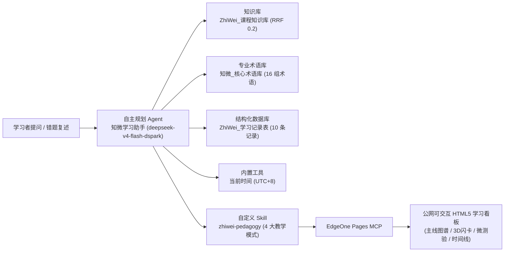

# 知微学习助手（ZhiWei Learning Copilot）

取意“**见微知著**”，面向大学生课程深度学习与期末备考场景，针对“**只刷题不诊断、只看答案不理解、学完即忘**”三大痛点构建基于 **EPAI 平台** 的自主规划智能体与云端交互式学习看板系统。

- **GitHub 项目主页（Project Landing Page）**：https://qiontoo.github.io/zhiwei-learning-copilot/
- **云端交互体验看板（GitHub Pages Cloud App）**：https://qiontoo.github.io/zhiwei-learning-copilot/app/
- **EPAI EdgeOne Pages MCP 实测公网发布页**：https://mcp.edgeone.site/share/JzNFzRrL89dVqtvpMy50d

---

## 1. 核心定位与教学方法论

通用大模型默认“直接给完整答案”，学生容易产生“看懂即学会”的错觉；传统题库与静态闪卡无法针对个人错误思路进行追问。**知微学习助手**将课程知识拆解为原子级微概念（Micro-Concepts），坚持**不剧透完整答案**，完整闭环如下：

1. **微概念诊断与前置回溯**：先定位卡点微概念及其前置依赖；若前置掌握度 `< 60`，先补前置概念再回到当前题。
2. **费曼 3 轮渐进追问**：学生用大白话复述或答错时，先肯定正确直觉，再单点追问 1 处核心漏洞，最多 3 轮收敛。
3. **4 类标准错因归因**：精准归因为 `概念不清` / `前置缺失` / `审题偏差` / `推导跳跃`。
4. **艾宾浩斯复习调度**：锚定 `当前时间 (UTC+8)` 动态规划当日重测、+1 天、+3 天、+7 天复习节点，每轮输出结构化「📊 知微学习状态卡」。
5. **一键发布可交互 HTML5 看板**：通过 `zhiwei-pedagogy` Skill 生成自包含单文件网页，并调用 **EdgeOne Pages MCP** 发布为现场可点击体验的公网链接。

---

## 2. EPAI 平台架构与六大组件联动



| 层级 | EPAI 组件名 | 资产内容与作用 |
| --- | --- | --- |
| 知识检索层 | `ZhiWei_课程知识库` | 收录《机器学习基础》（`ML-01~ML-08`）与《数据结构与算法》（`DS-01~DS-06`）共 14 张微概念卡 |
| 术语对齐层 | `知微_核心术语库` | 16 组高频易混术语对（如 `LayerNorm vs BatchNorm`、`摊还 vs 平均复杂度`），强制术语零歧义 |
| 状态数据层 | `ZhiWei_学习记录表` | 记录 `concept_id`、`mastery_score`、`error_type`、`next_review_at`（当前版本为只读诊断快照） |
| 教学技能层 | `zhiwei-pedagogy` | 封装微诊断、费曼 3 轮追问、4 类错因归因与自包含 HTML5 学习看板模板规范 |
| 云端交付层 | `EdgeOne Pages MCP` + `当前时间` | 一键发布单文件 HTML5 看板为公网 URL，并基于 UTC+8 精确计算艾宾浩斯复习节点 |
| 安全与记忆 | `长期记忆` + `内容安全审核` | 沉淀非敏感学习偏好；拦截整份作业/考试抄袭请求并自动切换为思路拆解模式 |

---

## 3. 工程排障实证：知识库零命中修复

在 EPAI 端到端测试中，最初 `ZhiWei_课程知识库` 在检索时返回 **0 条命中**。经过底层排查：
- **根因**：平台默认采用 `相似度得分` 融合（0.2 关键词 / 0.8 语义）且 `语义相似度阈值 = 0.5`，而 `bce-embedding-base_v1` 对具体课程提问的语义得分在 `0.1557 ~ 0.4577` 之间，导致有效卡片被阈值过滤。
- **修复方案**：在智能体知识库参数配置中将融合策略切换为 **`倒数排名 (fusion_rrf)`** 并将阈值设为 **`0.2`**。
- **验证结果**：实测查询稳定命中两份课程文档共 **10 条卡片片段**（匹配度 `0.00 ~ 0.95`），智能体并能主动交叉识别出学习记录表（`ML-03 / ML-05`）与知识库卡片（`ML-03 / ML-06`）之间的编号差异。

---

## 4. 仓库目录结构

```text
zhiwei-project/
├── README.md                                  # 项目说明与工程实证
├── prompt_知微学习助手.md                      # EPAI 自主规划智能体系统 Prompt
├── knowledge/                                 # 课程微概念卡片（14 个原子概念）
│   ├── 机器学习基础_微概念卡片.md
│   └── 数据结构与算法_微概念卡片.md
├── terminology/                               # 16 组核心易混术语表
│   └── ZhiWei_核心概念术语表.xlsx
├── database/                                  # 学生掌握度与复习调度样例数据
│   ├── ZhiWei_学习记录表.csv
│   └── ZhiWei_学习记录表.xlsx
├── skills/zhiwei-pedagogy/                    # EPAI 自定义教学 Skill
│   └── SKILL.md
├── docs/                                      # GitHub Pages 项目主页与云端交互看板
│   ├── index.html
│   ├── app/index.html
│   └── assets/
├── deliverables/                              # 路演与交付资产
│   ├── ZHIWEI_LIS_学习看板_v2.html
│   ├── Demo_Day_演示与录屏脚本.md
│   └── 知微学习助手_项目方案_苏州大学.pptx
└── screenshots/                               # 端到端实测与界面截图
```

---

## 5. 事实边界与当前限制（Truthfulness & Scope）

1. **EPAI 平台审批状态**：当前 EPAI 智能体处于 `V1: 待审批` 状态，平台内置公网 UI/API 链接尚未开放，因此站外交互体验由 **EdgeOne Pages MCP**（[v2.0 公网看板](https://mcp.edgeone.site/share/JzNFzRrL89dVqtvpMy50d)）与 **GitHub Pages**（[云端镜像](https://qiontoo.github.io/zhiwei-learning-copilot/app/)）提供。
2. **数据库读写边界**：当前 EPAI `ZhiWei_学习记录表` 作为只读学习状态快照读取，网页微测验结果在对话/页面内即时计算，暂未自动写回 EPAI 数据库，后续版本将补齐双向写库工具。
